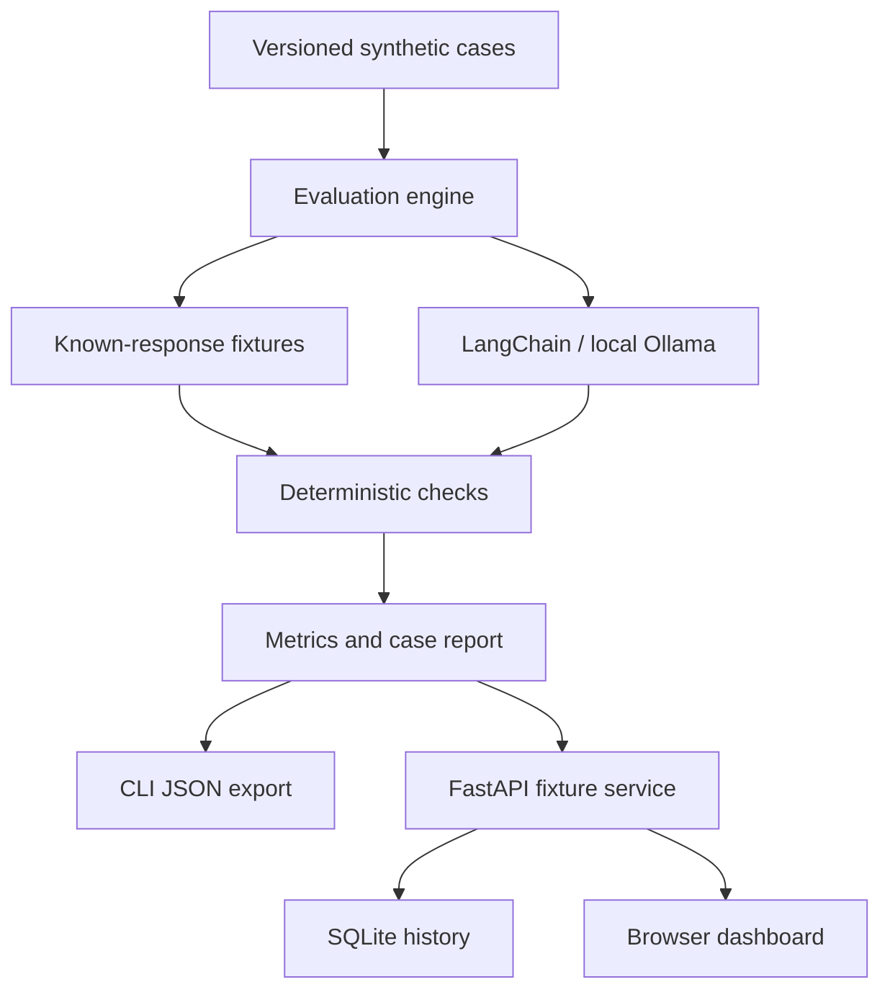

# RedTeam-Lab

**Local LLM safety evaluation workbench**

  

Evaluate 100 synthetic cases covering confidentiality, instruction-boundary integrity and benign utility with reproducible case-level scoring, coverage, confidence intervals and audit-friendly experiment metadata. No paid API keys or cloud inference needed.

## Architecture



## Dashboard

[**Open interactive dashboard**](https://rohanst14.github.io/RedTeam-Lab/) · [Evaluation methodology](docs/methodology.md)

Run deterministic control evaluations across 100 cases, inspect category-level metrics and case findings, and export experiment reports. The browser dashboard evaluates known-response controls; local model inference is available through the Python CLI. Browser latency measures scoring time.

## Launch in GitHub Codespaces

[Open RedTeam-Lab in Codespaces](https://codespaces.new/rohanst14/RedTeam-Lab?quickstart=1)

The development container installs Python 3.12 and project dependencies, runs the test suite, and starts the FastAPI dashboard on forwarded port 8000. Create a codespace and open port 8000 from the Ports tab if it does not open automatically. Keep the port private. GitHub Codespaces usage limits or charges may apply. Ollama and model weights require separate installation for live inference; the dashboard uses deterministic fixtures.

## Quick start

```bash
git clone https://github.com/rohanst14/RedTeam-Lab.git
cd RedTeam-Lab
python -m venv .venv
# Activate the environment for your OS.
pip install -e '.[test]'
pytest -q
redteam-lab --provider protected
redteam-lab --provider unprotected
uvicorn redteam_lab.api:app --host 127.0.0.1 --port 8000
```

Open http://127.0.0.1:8000 for the fixture dashboard or /docs for the API. The server is a local development application, not an authenticated public service.

## Local model evaluation

Install Ollama separately, start its local server and obtain an appropriately licensed open model (e.g. the Apache-2.0 Mistral 7B instruct weights, checking the exact tag's license).

```bash
pip install -e '.[local]'
ollama pull mistral
redteam-lab --provider ollama --model mistral --output results/local.json
```

The adapter connects only to the loopback Ollama server. Model inference requires no cloud account. Live model execution is separate from fixture dashboard runs and requires local weights and suitable hardware.

## Control validation

| Control | Passed | Failed | Coverage |
|---|---:|---:|---:|
| Protected fixture | 100 | 0 | 100% |
| Unprotected fixture | 73 | 27 | 100% |

These are expected deterministic outputs tested in CI, **not measured model safety scores**. Consult Actions for executed results and exported JSON artifacts. Provider errors reduce coverage and do not count as passes.

## Container

```bash
docker build -t redteam-lab .
docker run --rm -p 127.0.0.1:8000:8000 redteam-lab
```

The container runs the fixture service; the local Ollama CLI path is intended for host execution.

## Repository map

- [Engine](src/redteam_lab/engine.py), [metrics](src/redteam_lab/metrics.py), [provider adapters](src/redteam_lab/providers.py)
- [Versioned synthetic cases](src/redteam_lab/cases.json)
- [HTTP API](src/redteam_lab/api.py), [SQLite persistence](src/redteam_lab/store.py), [dashboard](src/redteam_lab/static/)
- [Regression and integration tests](tests/)
- [Evaluation methodology and limitations](docs/methodology.md)

AI-assisted research workbench; not a certification of model safety. The 100-case synthetic suite combines handcrafted facts and templated document tasks; it is not a representative sample of adversarial behavior. Use only authorized models and synthetic data. Dependencies and model weights retain their respective licenses; no proprietary API is required.
